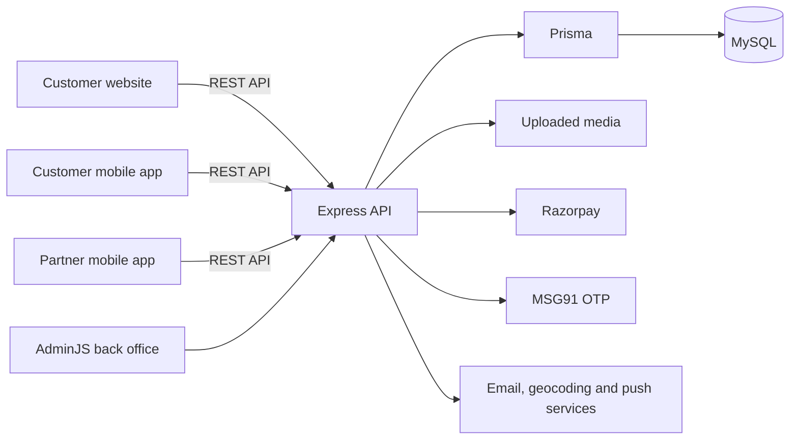

# Tokriii Project Summary

This document describes the project as found in the repository on 12 November 2026. It is a code-structure and connection overview; it does not claim that every feature has been tested end to end.

## 1. Project overview

Tokriii is a fruit-store platform with four main parts:

1. A customer website built with React, supporting both Vite and Next.js.
2. An Express backend with an AdminJS back office, Prisma, and MySQL.
3. An Expo/React Native customer mobile app.
4. An Expo/React Native delivery-partner mobile app.

The clients communicate with the backend through the versioned REST API under `/api/v1`. The backend owns the business logic and database access. Availability of features depends on the environment, configuration, and deployed version.

## 2. Main directories

| Path | Purpose |
| --- | --- |
| `src/` | Website frontend, shared UI, state, and API clients. |
| `src/app/` | Next.js routes, layouts, metadata, sitemap, and server-side content loading. |
| `src/pages/` | React storefront page components used by the website. |
| `src/components/` | Reusable website UI components. |
| `src/context/` | Website authentication, cart, and address state. |
| `src/lib/` | Website API, checkout, location, analytics, image, and navigation helpers. |
| `server/` | Express API, AdminJS, database schema, business services, scripts, and uploads. |
| `tokri-mobile-go/` | Customer mobile app. |
| `tokri-partner-go/` | Delivery-partner mobile app. |
| `public/` | Public website assets. |
| `docs/` | Existing project reports, screenshots, and migration materials. |
| `scripts/` | Project-level operational and verification scripts. |

## 3. Website frontend

### Technology and entry points

- `package.json`: website dependencies and commands for Vite and Next.js.
- `src/main.jsx`: Vite entry point; initializes the React app, browser router, analytics, and image fallback.
- `src/App.jsx`: React Router storefront shell and routes.
- `src/app/layout.next.jsx`: Next.js root layout and metadata.
- `src/app/(store)/`: Next.js storefront routes; some routes reuse existing React components.
- `vite.config.js`: Vite server and proxy configuration.
- `next.config.mjs`: Next.js rewrites for API, uploads, back office, and partner pages, plus indexing headers.
- `src/lib/api.js`: browser-side API requests, authorization headers, and asset URL handling.
- `src/lib/server/public-api.js`: server-side, unauthenticated public API requests for Next.js.
- `src/lib/server/content.js`: helpers for server-rendered product, blog, and CMS content.

### Features and key files

| Feature | Website files | Backend connection |
| --- | --- | --- |
| Home, categories, and products | `src/pages/Home.jsx`, `src/pages/ShopAllPage.jsx`, `src/pages/ProductDetail.jsx`, `src/components/HomeCategoryFeed.jsx` | `GET /settings/public`, `/categories`, `/products`, `/products/:slug` |
| Search | `src/components/SearchBox.jsx` | `GET /search` |
| Login | `src/hooks/useLoginFlow.js`, `src/components/LoginPopup.jsx`, `src/context/AuthContext.jsx` | `POST /auth/send-otp`, `/auth/verify-otp`; `GET /auth/me` |
| Cart and pricing | `src/context/CartContext.jsx`, `src/components/CartDrawer.jsx`, `src/pages/CartPage.jsx` | `/account/cart`, `POST /checkout/quote`, `/checkout/preview-coupon` |
| Addresses and profile | `src/context/AddressContext.jsx`, `src/components/account/`, `src/pages/MyAccount.jsx` | `/account/addresses`, `/account/profile` |
| Checkout and payments | `src/pages/CheckoutPage.jsx`, `src/pages/OrderSuccessPage.jsx`, `src/lib/checkout.js` | `/checkout/config`, `/checkout/create-order`, `/checkout/confirm-cod`, payment verification, synchronization, and status endpoints |
| Customer orders and invoice | `src/components/account/MyOrders.jsx`, `src/lib/api.js` | `/account/orders`, `/account/orders/:orderNo/invoice` |
| Blogs, pages, and reviews | `src/pages/BlogListPage.jsx`, `src/pages/BlogDetailPage.jsx`, `src/pages/CmsPage.jsx`, `src/components/Reviews.jsx` | `/blogs`, `/pages/:slug`, `/reviews` |
| SEO and analytics | `src/app/sitemap.xml/route.next.js`, `src/app/robots.txt/`, `src/lib/telemetry.js`, `src/lib/metaPixel.js` | Public API content, website metadata, and analytics configuration |

## 4. Backend and back office

### Entry points and layers

- `server/src/server.js`: initializes Express, CORS, uploads, AdminJS, API routes, Razorpay webhook/callback routes, and storefront serving or proxying. It connects Prisma before listening.
- `server/src/config/env.js`: backend environment configuration.
- `server/src/routes/api.js`: public API router and mounts for auth, account, checkout, app, and partner routes.
- `server/src/routes/`: HTTP routes and request handling.
- `server/src/services/`: reusable business logic and integrations.
- `server/src/middleware/`: customer authentication, partner authentication, and error handling.
- `server/src/lib/prisma.js`: Prisma client.
- `server/prisma/schema.prisma`: MySQL models and relations.
- `server/prisma/migrations/` and `server/prisma/seed.js`: migrations and seed data.
- `server/src/admin/`: AdminJS configuration, management screens, handlers, and permission logic.
- `server/uploads/`: files served through `/uploads`.

### API route map

All paths below are relative to `/api/v1` unless stated otherwise.

| Route group | File | Purpose |
| --- | --- | --- |
| `/health`, `/categories`, `/products`, `/search`, `/settings/public`, `/blogs`, `/pages`, `/reviews`, `/geo/reverse` | `server/src/routes/api.js` | Public storefront data and reverse geocoding. |
| `/auth` | `server/src/routes/auth.js` | Customer OTP, session identity, and logout. |
| `/account` | `server/src/routes/account.js` | Customer profile, addresses, orders, invoices, cart, and device tokens. |
| `/checkout` | `server/src/routes/checkout.js` | Checkout configuration, quotes, coupons, order creation, COD, payment, and status. |
| `/app` | `server/src/routes/app.js` | Mobile bootstrap data and release policy. |
| `/partner` | `server/src/routes/partner.js` | Partner login, account, assigned orders, cash collection, payment QR, and device token. |
| `/media` | `server/src/routes/media.js` | Media listing, upload, and deletion. |
| `/webhooks/razorpay` | `server/src/routes/webhooks.js`, mounted in `server/src/server.js` | Razorpay webhook processing. |
| `/checkout/razorpay-callback` | `server/src/routes/checkout.js`, mounted in `server/src/server.js` | Razorpay checkout callback. |
| `/partner` pages | `server/src/routes/partnerPages.js` | Browser pages for partner password setup and reset, outside the API route group. |

### Business services

| Area | Important files |
| --- | --- |
| Customers and login | `services/customers.js`, `services/otp.js`, `services/msg91.js`, `services/jwt.js` |
| Catalog and pricing | `services/pricing.js`, `services/catalogImportExport.js`, `utils/catalog.js`, `utils/formatters.js` |
| Cart, coupons, and checkout | `services/cart.js`, `services/coupons.js`, `services/checkout.js` |
| Delivery | `services/addresses.js`, `services/delivery.js`, `services/deliveryQuote.js`, `services/freeDelivery.js` |
| Orders and invoices | `services/customerOrders.js`, `services/partnerOrders.js`, `services/invoice.js` |
| Payments | `services/razorpay.js`, `services/checkout.js`, `routes/webhooks.js` |
| Apps and notifications | `services/appRelease.js`, `services/devices.js`, `services/push.js`, `services/email.js` |

These service paths are under `server/src/`.

### Main database models

`server/prisma/schema.prisma` defines models including customers, users and admin permissions; products, categories and media; carts and cart items; orders and order items; coupons and redemptions; settings and content; OTP requests and device tokens; delivery partners and serviceable pincodes; and app release policies. Prisma connects those models to MySQL.

## 5. Customer mobile app

The customer app lives in `tokri-mobile-go/` and uses Expo, React Native, React Navigation, and AsyncStorage.

| File or directory | Purpose |
| --- | --- |
| `App.js` | Composes theme, authentication, address, cart, update gate, and navigation providers. |
| `src/navigation/RootNavigator.js` | Main tabs and screen navigation. |
| `src/config.js` | API host selection and theme constants. |
| `src/lib/api.js` | API requests, bearer token headers, app build headers, and asset URLs. |
| `src/context/AuthContext.js` | Customer session persistence and profile updates. |
| `src/context/CartContext.js` | Local cart, account cart synchronization, quote, and coupon preview. |
| `src/context/AddressContext.js` | Customer address selection and retrieval. |
| `src/screens/` | Home, shop, search, product, login/OTP, cart, account, orders, reorder, and UPI screens. |
| `src/components/AppUpdateGate.js` | Checks the backend app release policy. |
| `src/components/RazorpayCheckout.js`, `PaymentSheet.js` | Payment UI and checkout integration. |
| `eas.json`, `app.config.js` | Build profiles and Expo app configuration. |

The app uses `/app/bootstrap` for initial store data, catalog APIs for browsing, `/auth` for OTP login, `/account` for customer data, and `/checkout` for order and payment operations. Session and other local state are stored in AsyncStorage; authenticated cart and customer data also use the backend.

## 6. Delivery-partner mobile app

The partner app lives in `tokri-partner-go/` and is a separate Expo/React Native app.

| File or directory | Purpose |
| --- | --- |
| `App.js` | Initializes the app and authentication provider. |
| `src/navigation/RootNavigator.js` | Switches between login and delivery screens. |
| `src/config.js` | Selects the API host. |
| `src/lib/api.js` | Partner login, account, order, cash-collection, and payment-QR requests. |
| `src/context/AuthContext.js` | Partner session persistence. |
| `src/screens/LoginScreen.js` | Partner login and password recovery entry. |
| `src/screens/OrdersScreen.js`, `OrderDetailScreen.js` | Assigned delivery orders and payment actions. |
| `eas.json`, `app.config.js` | Expo build profiles and app configuration. |

The app authenticates against `/partner/auth/login`, loads `/partner/me` and `/partner/orders`, and sends order-specific requests to `/partner/orders/:id/collect-cash` and `/partner/orders/:id/payment-qr`. Its order-detail helper currently finds the order from the list response, although the backend also defines a detail endpoint.

## 7. How the parts connect

### Browsing and content

1. The website or customer app requests public catalog or content data from `/api/v1`.
2. `server/src/routes/api.js` reads data through Prisma and formats the response.
3. The client displays the data and resolves product image URLs to uploaded assets.
4. Next.js can also retrieve public data server-side through `src/lib/server/public-api.js`.

### Customer login, cart, and checkout

1. Website and mobile login screens request and verify an OTP through `server/src/routes/auth.js` and the OTP/MSG91 services.
2. The client stores the returned session and sends a bearer token on authenticated requests.
3. Cart and address requests go through `server/src/routes/account.js` to the relevant services and MySQL.
4. Checkout quote and coupon preview use the checkout and pricing services; creating an order requires customer authentication.
5. COD confirmation or Razorpay/UPI payment processing updates the order through checkout services. Razorpay can also call the backend webhook and checkout callback.
6. The website and app retrieve customer orders through the account API.

### Delivery partner

1. An administrator manages delivery-partner and order data through the back office.
2. A partner signs in to the partner app and receives a partner token.
3. Partner routes authenticate the token and return assigned order information.
4. Cash-collection and payment-QR actions are sent to the partner order services and update or use backend order/payment data.

## 8. Environment and routing

- Website browser API calls use `https://tokriii.com/api/v1` on production website hosts and the current origin's `/api/v1` on other hosts. The Vite and Next configurations include API and upload proxies/rewrites.
- Next.js server-side public requests default to `http://127.0.0.1:5223`, configurable through `TOKRIII_SERVER_API_ORIGIN`.
- Customer mobile app: `EXPO_PUBLIC_API_BASE_URL` overrides the API; the EAS staging profile targets `server.tokriii.com`, while preview/production target `tokriii.com`. Without an override, its configuration defaults to the live API except for a staging build profile.
- Partner app: the environment override takes precedence; its configuration defaults to staging unless the build profile is production. EAS profiles explicitly set the corresponding URL.
- Both mobile API helpers contain special handling that resolves `/uploads` paths to the live host. This matters when checking staging-only images.
- The actual public deployment can include reverse proxies and environment settings outside this repository. The configuration files describe intended routing, not proof of every deployed path.

## 9. Verification and observations

- During the inspection, `/api/v1/health` returned HTTP 200 on `https://tokriii.com`, `https://server.tokriii.com`, and local port 5222. Local port 5223 was not accepting connections at that time. Health responses alone do not establish that database queries, authentication, orders, payment providers, or mobile flows work end to end.
- `server/src/middleware/customerAuth.js` falls back to identifying a customer using the `X-User-Phone` header when no bearer token is present. Account routes use this middleware; the authorization implications should be reviewed as a priority.
- Some existing documentation is out of date: `server/README.md` describes a static-data frontend, and `tokri-mobile-go/README.md` mentions Expo SDK 54 while `tokri-mobile-go/package.json` declares SDK 57. Treat code and deployment configuration as the current source for these details.
- The repository contained pre-existing uncommitted and untracked files when inspected. This summary does not evaluate or modify them.
