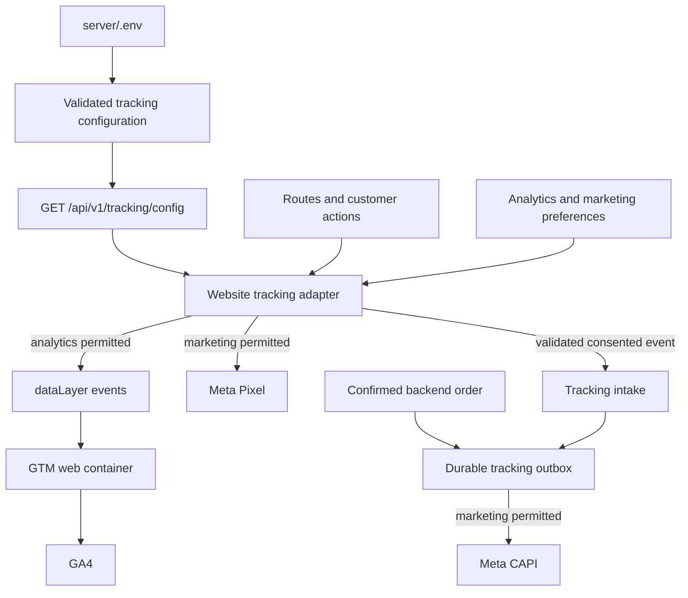

# Pixel, GTM, GA4, and CAPI Implementation Plan

Status: implementation prepared in the workspace. Production migration, deployment, GTM publishing and account-side delivery checks are separate activation steps. See VERIFICATION.md for actual evidence and operational limits.

Prepared from the repository inspection on 12 November 2026. Use this document with [SETUP_GUIDE.md](SETUP_GUIDE.md).

## 1. Objective and scope

Make website tracking configurable through the backend environment, introduce a shared commerce-event interface, and deliver consented events to Meta Pixel, Google Analytics 4 through Google Tag Manager, and Meta Conversions API.

The initial scope covers the Next.js website, its Vite fallback, and the Express backend. Native customer-app and partner-app tracking are a separate phase: a web GTM container and browser Pixel do not instrument React Native apps. Existing installed apps will not change when server environment variables change.

## 2. Current state

| Area | Current implementation | Work required |
| --- | --- | --- |
| Meta Pixel | `src/lib/metaPixel.js`; hardcoded ID `891089060757681`; consented PageView on production hosts | Runtime ID, shared event adapter, commerce events, shared CAPI event IDs |
| Consent | `src/components/MarketingConsent.jsx`; marketing choice persisted in a cookie | Separate analytics and marketing preferences, consent version, unified vendor updates |
| GA4 | `src/lib/telemetry.js`; direct Google tag, manual page views | Replace with selected GTM ownership, runtime configuration, commerce events, consent |
| GA configuration | Vite uses `VITE_GA_MEASUREMENT_ID`; Next embeds `TOKRIII_GA_MEASUREMENT_ID` at build time | One backend-owned public configuration source |
| GTM | No container integration found | Consent-aware loader and documented container configuration |
| CAPI | No integration found | Backend sender, validation, persisted consent/attribution, durable purchase delivery |
| Purchases | Browser success page, checkout services, Razorpay webhook/recovery, partner payment services | One authoritative purchase definition and idempotent event creation |

The reviewed live Next.js chunk had an empty GA measurement ID. This is an inspection result, not a guarantee of the site's future deployment state.

## 3. Architecture and event ownership



Default design:

- GTM owns GA4 delivery. Remove direct GA initialization when this mode is enabled.
- The website owns Meta Pixel delivery. Do not install another Meta Pixel tag in GTM.
- The backend owns CAPI delivery. Never expose its token or accept an arbitrary destination/token from a browser.
- Use one shared application event schema. Translate it to the destination-specific schemas.
- Generate each event once at the action's successful boundary; views need route-instance deduplication, not a permanent product-ID suppression.
- Deploy the first code change normally. Subsequent public ID changes require backend restart and a page reload, without rebuilding the website.
- Already open tabs retain their loaded vendor configuration until refreshed. ID rotation must not silently mix old Pixel and new CAPI destinations.

GTM data-layer events and variables follow Google's [data layer documentation](https://developers.google.com/tag-platform/tag-manager/datalayer).

## 4. Proposed environment contract

These variables are implemented in the backend configuration. Public IDs load at runtime; enable only after the migration and release steps in SETUP_GUIDE.md.

```dotenv
# server/.env: public configuration and switches
TRACKING_ENABLED=false
TRACKING_ALLOWED_HOSTS=tokriii.com,www.tokriii.com
TRACKING_GTM_ENABLED=false
TRACKING_GTM_CONTAINER_ID=
TRACKING_GA4_MEASUREMENT_ID=
TRACKING_META_PIXEL_ENABLED=false
TRACKING_META_PIXEL_ID=
TRACKING_CURRENCY=INR
TRACKING_CONFIG_VERSION=1

# server/.env: private server configuration
META_CAPI_ENABLED=false
META_CAPI_ACCESS_TOKEN=
META_CAPI_API_VERSION=
META_CAPI_TEST_EVENT_CODE=
```

Validation must reject invalid IDs/hosts and fail closed for an enabled provider with incomplete configuration. Select a supported Meta API version when implementing; do not use an unversioned endpoint or invent a version here.

`GET /api/v1/tracking/config` will return only explicitly allowlisted public fields: enabled flags, production host list, IDs, currency, configuration version, and whether browser-to-server event forwarding is available. It must use `Cache-Control: no-store`. Never serialize `process.env` or return credentials, the CAPI test code, or private backend URLs.

Use the same validated configuration for Pixel JavaScript and the Next.js noscript fallback. Remove the hardcoded noscript ID. Where runtime/consent gating cannot be guaranteed, omit vendor noscript fallbacks rather than bypass consent.

## 5. Event map

Names below are the application/data-layer names and their destination mappings. GTM is a delivery mechanism, not a separate analytics destination.

| Trigger | Application / GA4 name | Meta name | CAPI scope |
| --- | --- | --- | --- |
| Safe initial page and route change | `page_view` | `PageView` | Consented, validated intake |
| Loaded product detail | `view_item` | `ViewContent` | Consented, validated intake |
| Successful first-page public search response | `search` | `Search` | Consented, sanitized search only |
| Successful cart addition or positive quantity delta | `add_to_cart` | `AddToCart` | Consented, validated intake |
| Successful cart removal or negative quantity delta | `remove_from_cart` | None initially | None initially |
| Cart viewed | `view_cart` | None initially | None initially |
| Checkout displayed with usable cart | `begin_checkout` | `InitiateCheckout` | Consented, validated intake |
| Payment method committed | `add_payment_info` | `AddPaymentInfo` | Consented, validated intake |
| Backend-confirmed purchase | `purchase` | `Purchase` | Authoritative backend event |

Use the GA4 ecommerce schema, including items and currency/value where appropriate, as described in Google's [ecommerce guide](https://developers.google.com/analytics/devguides/collection/ga4/ecommerce).

Common event fields: event ID, event time, safe page type/path, source (`web`), currency, value, and items. Items contain stable product IDs, names, unit prices, quantities, and optional category. Confirm catalog ID compatibility before Meta dynamic-ad use. GA purchase value will be discounted merchandise revenue excluding tax and shipping; send tax and shipping separately. Keep handling/small-cart fees separate and document reconciliation against the order grand total. Meta Purchase value will use the confirmed order grand total; explicitly document this difference in reporting.

Do not send arbitrary form contents, addresses, phone numbers, emails, OTPs, authentication/payment tokens, or raw order URLs to the data layer. Search events require sanitization and must drop sensitive-looking input. Automatic vendor URL/referrer collection also needs inspection; sanitizing custom parameters alone is insufficient.

## 6. Consent and host behavior

- Add separate analytics and marketing controls, with reject-all and a persistent settings entry.
- Preserve an existing marketing rejection. Existing marketing acceptance does not automatically grant analytics consent; unknown preferences remain denied.
- Adopt basic consent behavior initially: no vendor loader/event forwarding before the relevant choice. Load GTM only after analytics or marketing consent; individual tags must still require their own category.
- Set the four Google consent fields before tags can send: `analytics_storage`, `ad_storage`, `ad_user_data`, and `ad_personalization`.
- Configure GTM consent initialization/update through a consent template and GTM consent APIs. Marketing-only consent must not trigger GA; analytics-only consent must not trigger Pixel/CAPI or advertising tags.
- On withdrawal, update vendor consent immediately, stop subsequent adapter events, and remove application-owned attribution state as appropriate. Vendor cookie cleanup must be evaluated explicitly; do not claim that unloading a script removes cookies.
- Never replay historical actions collected while consent was denied. Initial acceptance may track the current safe page.
- Default staging/local hosts to disabled and use isolated mocks or dedicated test destinations for verification.

Google describes the required default/update ordering and GTM-specific consent APIs in its [consent guide](https://developers.google.com/tag-platform/security/guides/consent).

## 7. Backend purchase and CAPI reliability

1. Define purchase as online payment confirmed by the backend, or COD order explicitly confirmed (confirmed by the project owner). A later COD cash/QR collection must not create another Purchase. Failed, abandoned, and unconfirmed orders do not qualify.
2. Persist order source, consent snapshot/version/time, approved attribution, safe source URL, opaque tracking transaction ID, and stable purchase event ID. Do not label native-app orders as website purchases.
3. Integrate event creation with the authoritative order transition, using a transaction and a unique outbox key. Cover checkout verification, Razorpay callback/webhook/recovery, and QR paths. Existing orders without recorded tracking consent/source should not be backfilled automatically.
4. Enqueue a durable CAPI Purchase once. Return its same ID and backend-derived amounts/items to the authenticated website so Pixel can use the corresponding browser `eventID` and CAPI the server `event_id` with the same Meta event name.
5. Use an outbox worker with timeouts, bounded exponential retry, provider response inspection, and redacted logs. Restarts must not lose pending purchases. Tracking failures must not fail checkout or webhook acknowledgement after order persistence.
6. Store destination/configuration version on the outbox event. Process only against the intended configured Pixel; destination changes must not send an old browser event to a different dataset. Hold incompatible pending events for an explicit operational decision.
7. Require consent evidence and schema validation at intake; enforce payload limits, event allowlists, rate limits, origin/host checks, and a bounded same-origin session mechanism. Origin checks alone are not authentication. Do not use the legacy phone-only customer fallback as proof of identity. Browser-origin activity is still untrusted telemetry.
8. The intake must never create a Purchase from a browser-supplied amount/status. Resolve authenticated purchase ownership through a verified bearer token and database order. Webhook purchases must not depend on the customer keeping the browser open.
9. Normalize and hash eligible customer matching data only on the backend when permitted. Use Meta's field-specific rules: matching fields such as email/phone need normalization/hashing; IP, user agent and permitted `_fbp`/`_fbc` values are not SHA-256 hashed. Never log the token or full matching payload.
10. Persist consent/attribution only as needed. Recheck known revocation before dispatch; delete/drop revoked unsent matching data under the implemented policy. Record test-versus-production destination explicitly.

Meta implementation references: [Using the API](https://developers.facebook.com/docs/marketing-api/conversions-api/using-the-api/) and [Pixel/server deduplication](https://developers.facebook.com/docs/marketing-api/conversions-api/deduplicate-pixel-and-server-events/). These Meta pages returned HTTP 429 during this planning session; reconfirm their current requirements and supported Graph version before implementation.

## 8. File-by-file implementation sequence

The implementation uses the files listed below; the delivery worker is in `services/trackingPurchase.js` rather than a separate trackingOutbox module.

| Phase | Files | Deliverable |
| --- | --- | --- |
| 1. Runtime configuration | New `server/src/services/trackingConfig.js`, new `server/src/routes/tracking.js`, existing `server/src/routes/api.js`, `server/.env.example` | Validated public config route and private server settings |
| 2. Browser adapter | `src/lib/telemetry.js`, `src/lib/metaPixel.js`, new `src/lib/trackingConfig.js`, new `src/lib/trackingEvents.js` | Shared async initialization, strict adapters and event IDs |
| 3. Consent and shell | `src/components/MarketingConsent.jsx`, `src/app/_components/NextShell.jsx`, `src/main.jsx`, `src/App.jsx`, `src/app/layout.next.jsx` | Consent categories, route tracking, runtime noscript handling, Vite/Next parity |
| 4. Commerce instrumentation | `src/context/CartContext.jsx`, product/search/cart/checkout/order pages and native Next route components under `src/app/` | Action-based events with accurate deltas and no double instrumentation |
| 5. Persistent backend delivery | `server/prisma/schema.prisma`, new migration, `services/trackingPurchase.js`, `services/metaConversions.js`, checkout/partner services, `routes/webhooks.js`, server lifecycle | Consent/source persistence, purchase outbox, worker, shared event ID |
| 6. GTM account configuration | Container workspace plus setup guide | Runtime GA ID variable, Google tag, event tags, consent template, no duplicate Meta tag |
| 7. Verification and rollout | Existing Pixel suites; new adapter, purchase, outbox and browser tests; documentation | Reviewable test evidence, deployment and rollback instructions |

Inspect the native Next.js product and home routes as well as legacy pages; wiring only `src/pages/ProductDetail.jsx` would miss routes that render a different component.

## 9. Acceptance criteria

- Editing backend tracking IDs, restarting the correct backend process, and refreshing the page changes the selected IDs without a website rebuild.
- Private token/test code never appears in public config, HTML, JavaScript, data layer, logs, or source control.
- Safe defaults keep production/staging traffic isolated and disable invalid or missing destinations.
- First load, client navigation, back/forward, query navigation, and React development remounts produce the intended number of page views.
- Preference combinations, rejection persistence, withdrawal/reacceptance, configuration fetch failure and blocked SDKs behave correctly.
- One successful cart action yields one event with the actual quantity delta; hydration and server cart sync emit no add events.
- Online success, COD confirmation, failed payment, repeated callback/webhook, concurrent recovery, refresh, and partner collection produce the defined purchase count and accurate values.
- Pixel/CAPI purchase event IDs and names match; retries preserve the original event identity/time and destination.
- Outbox retries work after process restart and cannot interrupt checkout. Invalid client submissions cannot manufacture purchase revenue.
- GTM Preview/Tag Assistant, GA4 DebugView and Meta Test Events confirm actual delivery. Mock tests alone do not prove account-side receipt or deduplication.

## 10. Rollout and rollback

Implement with provider flags off, apply the reviewed database migration in the intended environment, and test isolated/local fixtures first. Then configure a GTM workspace and dedicated test destinations. Review test evidence and the exact production configuration before publishing/deploying.

The first release requires a website build, backend release, schema migration and configured/published GTM container. Later environment edits require a backend restart and page reload. Changing event code still requires deployment; changing native apps still requires an app release.

Rollback starts by disabling tracking flags and restarting the backend. New page loads stop loading tags; already open tabs must refresh or receive a deliberately implemented config refresh. Stop/pause outbox sends as part of rollback. Revert GTM to its prior published version if required; retain the outbox audit trail without resending events. Do not drop tracking tables as an emergency rollback action.

## 11. Information needed before activation

- Intended Meta Pixel/dataset ID; current code uses `891089060757681`.
- Intended GA4 web measurement ID; Vite currently declares `G-CPCXC2RBS8`.
- GTM web container ID and account/workspace access or owner-performed setup.
- CAPI access token stored privately in `server/.env` and a supported API version; optional test code for test destinations only.
- The project owner confirmed that a COD order counts as a purchase when confirmed. Confirm reporting values before production activation.
- Appropriate Meta/Google account access for final delivery verification.
